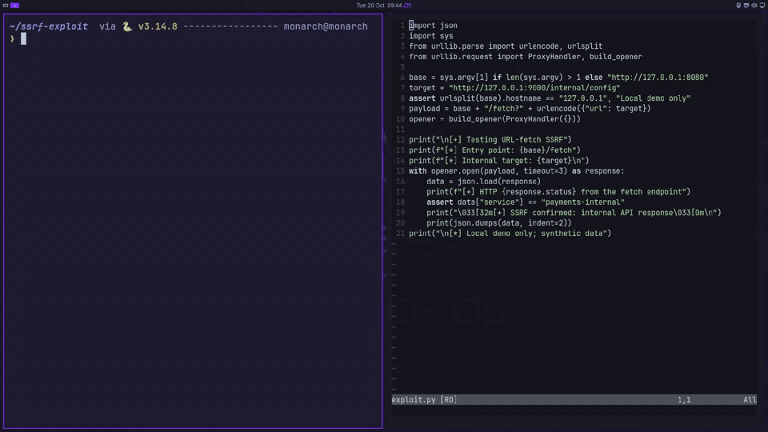

# Monarch

Monarch turns a fresh [CachyOS](https://cachyos.org) installation into a fully-configured, beautiful, and modern desktop — purpose-built as a **cybersecurity platform**, inspired by [SkillArch](https://github.com/laluka/SkillArch), with tools and aliases preinstalled.

Read the [documentation](https://docs.monarchlinux.com/) to install Monarch and get started.

*[Static preview](assets/demo.png).*

It runs its own desktop stack:

- **Compositor**: [Niri](https://github.com/YaLTeR/niri), a scrollable-tiling Wayland compositor, for a stable and ergonomic experience.
- **Desktop shell**: [Noctalia](https://github.com/noctalia-dev/noctalia), a native Wayland shell providing the bar, launcher, notifications, control center, lock screen, OSDs, wallpaper, and theming.

Monarch is a fork of [Omarchy](https://omarchy.org). The `monarch` CLI and the install scripts descend from it, and a good number of commands are still Omarchy's unchanged but for the name. The stack has since diverged — CachyOS rather than Arch, Niri rather than Hyprland, Noctalia rather than waybar and its neighbours — but the lineage is Omarchy's, and so is the licence.

## License

Monarch is released under the [MIT License](https://opensource.org/licenses/MIT), inherited from Omarchy.
