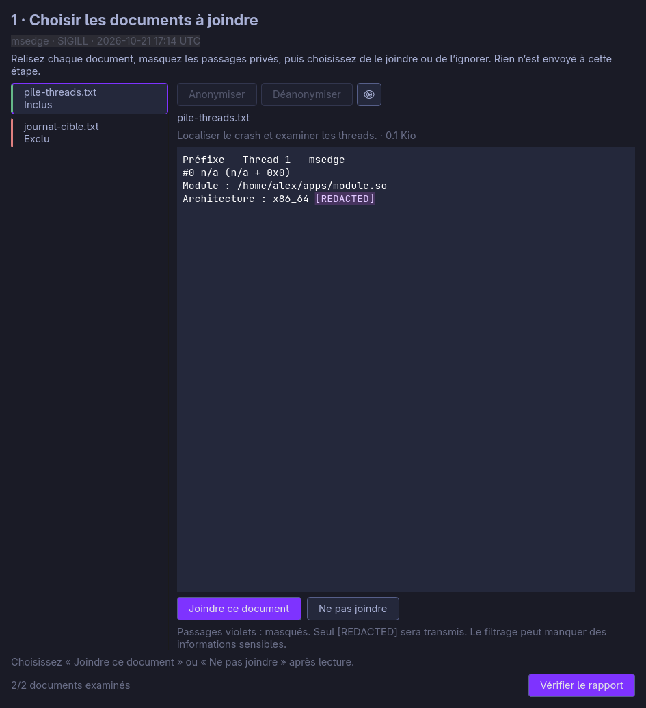

# Crash reporting

The implementation contract and compatibility notes below describe the native reviewer and collector boundary. Public user documentation in GitBook must be updated when this feature ships.

The GTK reviewer, its validation errors, AI instructions, public issue draft and Noctalia history panel support English and French through the existing Monarch catalogs. Language selection follows `MONARCH_LANGUAGE`, the saved Monarch language preference, then the locale, with English fallback. The panel passes its resolved language to the reviewer. Existing document contents, agent output and diagnostics are preserved rather than translated after approval.



Open **monarch-menu → System → Crashes** (`Win + Alt + Space`), or run:

```bash
monarch crash history
```

The panel shows the 100 most recent crashes recorded by `systemd-coredump` for
the current user, newest first. The details view shows the signal and core dump
availability. **Envoyer un rapport** opens the native GTK reviewer; **Analyser
avec l’IA** opens its separate deep-investigation consent screen.

The reviewer separates the base report, optional AI analysis, selected text
documents and additional user context. Open a document and choose **Joindre ce document** or **Ne pas joindre** to decide on that exact version. Selecting text and
choosing **Anonymiser** replaces it with `[REDACTED]`, highlighted in
the editor. Editing invalidates approval. Originals can be viewed locally and
are never included in the upload. The reviewer opens directly on the documents, with AI enrichment optional. Each document requires an explicit include or exclude decision; **Vérifier le rapport** remains disabled until all decisions are made. Editing a document invalidates its decision and disables progression again. A progress counter shows how many documents have been reviewed. Niri opens the reviewer as a 900 × 660 floating window.

Included and excluded documents retain text labels and have green and red leading borders, without redundant checkboxes. The eye toggle displays the local original read-only in the same pane; viewing it never changes the outgoing content. **Déanonymiser** restores the individual marker containing the cursor or selection, only when its exact source is available locally. Both initial filtering and manual redactions retain local source mappings; editing a marker invalidates its mapping rather than guessing its source. Markers supplied without a known source cannot be restored automatically. Source mappings never enter the outgoing payload. Restoring text invalidates approval like any other edit.

The compact review screen requests a 900 × 480 window with resizable columns: the included technical report, optional analysis and attachment count/size appear as plain sections on the left; optional reproduction context occupies the right column. Each document opens in a wide, read-only modal preview instead of expanding the summary. Only one preview is open at a time; **Fermer** or Escape returns to the unchanged summary. Context has a compact selection-only anonymization action and a UTF-8 byte counter. **Continuer** checks service availability and opens the destination confirmation; it does not send the report. A failed-send retry displays the frozen context read-only. Returning to the document editor restores its larger default size.

Only UTF-8 text is supported: 1 MiB per file, 5 MiB of attachments, up to 50 files.
There is no silent truncation. Failed anonymization requires explicit override
for each affected piece. Completed filtering is not a guarantee of anonymity.

The AI receives filtered copies in limited mode, with a skill directing it to
use only those inputs. This is an instruction boundary, not an OS sandbox.
Deep investigation requires separate consent and can read the local core and
targeted logs. Either mode may send data to the configured agent provider.
The agent writes a structured result in its job directory; choose **Importer
les résultats** after it finishes. Proposed documents remain unselected.

Repeated imports preserve existing attachments and their decisions. New attachments whose names collide receive numbered names such as `thread-stacks-2.txt`, respecting the filename length limit. New attachments and replacement analyses always require a new decision; invalid results roll back the import.

Sending shows the destination and advertised retention period (at most 90 days).
Only the exact reviewed payload is uploaded; failed sends retain a frozen copy
and idempotency key for retry. Success or explicit abandonment deletes draft
copies, leaving source files and system cores intact. Closing offers to retain
the draft instead. Receipts survive cleanup and require Cloudflare Access to
view; **Créer une issue GitHub** opens a public draft on `monarch-os/monarch`
containing the private report URL, not its analysis or attachments. It does not
publish an issue. Closing an issue does not automatically delete a report.

Cleanup errors are reported rather than treated as successful deletion. Failed abandonment leaves the window open. After successful upload, the receipt is saved before cleanup; if copies remain, the receipt screen warns and offers a local cleanup retry without uploading again. Reopening a receipt checks the draft directory even when partial cleanup removed its state file.

Drafts live under `${XDG_STATE_HOME:-~/.local/state}/monarch/crashes/drafts/`,
receipts under `crashes/receipts/`, with private permissions. Noctalia opens the
reviewer using its packaged runtime path. The reviewer uses GTK 4 and
python-gobject, and reads Noctalia's active palette when available.

```bash
monarch crash report '<id>'
monarch crash report '<id>' --analyze
```

The report contains the application, UTC date, signal, versions and backtrace
recorded in the journal. System versions reflect the time the report was
prepared. The package version comes from the crash metadata when available,
otherwise from the currently installed package. The backtrace is limited to
120 lines, and common private paths are redacted, including paths with spaces
or parentheses. Review the contents before sharing.

The base report excludes memory, environment, command line and general logs.
Additional journal-derived documents preserve recorded thread addresses, module
metadata and build IDs where available. Agent-proposed excerpts are separate
attachments subject to review. Reports are sent only after confirmation.

An event can remain in the journal after its core dump has been deleted. The
panel still displays it; an absent backtrace does not mean that no crash occurred.
Script exceptions without core dumps, normal exits and processes killed due to
memory exhaustion are outside the scope of this history.

Disable notifications through **Actions → Toggle → Crash Capture** or
`monarch toggle crash-capture`. This setting controls notifications; systemd
continues to retain crash events. A notification opens the matching crash in
this panel. When a default AI agent is configured, the crash details also offer
**Diagnostiquer avec l’IA**. No diagnosis or report submission starts until you
choose it.

## Command line

```bash
monarch crash history list
monarch crash history list --json
monarch crash history show '<id>' --json
monarch crash history report '<id>'
monarch crash history report '<id>' --json
monarch crash history export '<id>'
```

The identifier combines the boot ID, PID and crash timestamp to distinguish
events when the system reuses a PID. `list --json` returns `crashes`, `limit` and
`hasMore`; `show` fetches a specific crash even beyond the 100 listed entries;
`export` returns the file path as JSON. Journal access failures are
reported as errors instead of appearing as an empty history.

The legacy command supports `export '<id>' --stdin` to preserve previewed text even if the
journal rotates between preparation and export. This option accepts a text
report of up to 64 KiB. Without it, `export` prepares a new report.

The collection service and its dashboard are maintained separately from the
client packaged with the OS.

## Legacy command-line submission

The client stores a frozen, private preview before sending. It also works
independently of the panel:

```bash
monarch crash submit status
monarch crash submit prepare '<id>' | jq -r .text
monarch crash submit send '<id>' --confirm 'https://crashes.monarchlinux.com'
monarch crash submit copy '<id>'
```

`prepare` preserves the same report when reopened. Sending reuses that snapshot.
The response contains an `MCR-…` reference and a URL; retries after a network
failure use the same key to avoid duplicates. After receipt, the client retains
the reference and link and skips further uploads for that crash. `copy` places
the link on the clipboard without a network request.

The destination passed after `--confirm` must match the current configuration.
The caller passes the destination it displays, and the client rejects the upload
if it has changed since the availability check. On the command line, `--confirm`
without a destination confirms sending to the currently configured destination.

The client uses `https://crashes.monarchlinux.com` by default. The panel checks
the service's availability before enabling submission, and sending requires
explicit confirmation.

To override the destination or disable remote submission, create
`~/.config/monarch/crash-reporting.json`. For local previews and exports only:

```json
{"endpoint":""}
```

Both clients require HTTPS, reject redirects and send reports without
Cloudflare tokens. Reports and receipts are stored locally under
`${XDG_STATE_HOME:-~/.local/state}/monarch/crashes/submissions/`, with the same
private permissions as exports. The service advertises its remote retention
period; local files remain stored separately.

After a remote report is purged, its link indicates that it is unavailable or
expired. A link in a GitHub issue does not extend its retention period.

For local testing only, `MONARCH_CRASH_ENDPOINT=http://127.0.0.1:8787` together
with `MONARCH_CRASH_ALLOW_LOCAL=1` enables the local Worker.
